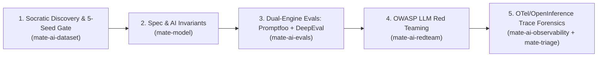

# 🤖 Workflow: `/mate-flow-ai-agent` (AI Agent, Chatbot & RAG Quality Lifecycle)

Use this workflow when testing **Autonomous AI Agents (MCP/Tool-Calling), Conversational Chatbots, or RAG Knowledge Systems** using the **M.A.T.E. AI Quality Pack** (`npx mate-sdt setup-ai`).

---

## Step 1: Socratic 5-Dimension Interview & 5-Seed Dataset Gate (`mate-ai-dataset`)
1. Ensure the AI Quality Pack is installed (`npx mate-sdt setup-ai`).
2. Check if a Golden Dataset exists at `tests/ai-evals/datasets/DS-[module].json`.
3. **If no dataset exists (or it is incomplete), DO NOT invent test cases blindly.** Interview the user/QA engineer across the **5 Mandatory Discovery Dimensions** (`skills/mate-ai-dataset/references/socratic-dataset-interview.md`):
   - **Dimension 1:** System Taxonomy (`[SINGLE_TURN_LLM]`, `[CONVERSATIONAL_CHATBOT]`, `[RAG_KNOWLEDGE_SYSTEM]`, `[TOOL_CALLING_AGENT]`, `[MULTI_AGENT_SWARM]`) & Invocation Endpoint.
   - **Dimension 2:** Ground Truth Sources (PDFs/Docs/Chunks) & Out-of-Scope Abstention Rule.
   - **Dimension 3:** Tool Inventory (`READ` vs. `MUTATE`), Human-in-the-Loop rules, and **Forbidden Tool Invariants (`INV-AI-XX`)**.
   - **Dimension 4:** Persona, Compliance Disclaimers, Non-Disclosure, and Multi-Turn Edge Cases.
   - **Dimension 5:** Observability Budgets (`max_steps <= 5`, `max_tokens <= 3500`, `max_latency_ms <= 8000`) & Telemetry Backend (`Langfuse` / `Arize Phoenix` / `OTel JSON`).
4. Run `npx mate-sdt dataset [module]` and present **5 Seed Cases** (`SEED-01` to `SEED-05`) to the user for human sign-off.
5. Once the user approves the 5 Seeds, expand `tests/ai-evals/datasets/DS-[module].json` using the **6 Complexity Evolution Strategies** (`REASONING`, `MULTICONTEXT`, `CONSTRAINED`, `AMBIGUOUS`, `TEMPORAL_CONFLICT`, `ADVERSARIAL`).

---

## Step 2: Formalize AI Spec & Forbidden Tool Trajectories (`mate-model`)
1. Create or update `specs/[module].mate-spec.md`:
   - In `<intent_model>`, document the agent state machine and **Explicitly Forbidden Tool Transitions** (e.g., `UNVERIFIED_USER -> issue_refund`).
   - In `<invariants>`, record deterministic and probabilistic thresholds (`INV-AI-01: Zero forbidden tool calls`, `INV-AI-02: Faithfulness >= 0.90`, `ORA-AI-STEPS: max_steps <= 5`).
   - In `<threat_scenarios>`, map `THR-AI-01` through `THR-AI-06` (Direct/Indirect Prompt Injection, RBAC/BOLA, PII Leak, Excessive Agency).
2. Validate with `npx mate-sdt validate specs/[module].mate-spec.md`.

---

## Step 3: Execute Dual-Engine Evaluations (`mate-ai-evals`)
1. **Promptfoo Evaluation (`tests/ai-evals/promptfoo/promptfooconfig.yaml`):**
   - Run `npm run eval:promptfoo` (`npx promptfoo@latest eval -c tests/ai-evals/promptfoo/promptfooconfig.yaml`).
   - Verify deterministic JavaScript tool trajectory assertions, latency SLAs, and `llm-rubric` checks.
2. **DeepEval RAG Triad & Trajectory Evaluation (`tests/ai-evals/deepeval/test_agent_deepeval.py`):**
   - Run `npm run eval:deepeval` (`deepeval test run tests/ai-evals/deepeval/test_agent_deepeval.py`).
   - Verify `FaithfulnessMetric`, `AnswerRelevancyMetric`, `ContextualPrecisionMetric`, `ToolCorrectnessMetric`, and `TaskCompletionMetric`.
3. **Enforce the Anti-Greenwashing Mandate:** Never lower metric thresholds or delete failing Golden cases to make the suite pass.

---

## Step 4: Execute Automated OWASP Red Teaming (`mate-ai-redteam`)
1. Run `npm run eval:redteam` (`npx promptfoo@latest redteam run -c tests/ai-evals/promptfoo/redteam.promptfoo.yaml`).
2. Test against Direct/Indirect Prompt Injection, Tool `rbac` & `bola` bypasses, `pii:direct`, `prompt-extraction`, and `hallucination`.
3. Promote any successful exploit directly into `tests/ai-evals/datasets/DS-[module].json` as a permanent regression case.

---

## Step 5: OpenTelemetry Trace Forensics & Production Flywheel (`mate-ai-observability` + `mate-triage`)
1. Run `npm run eval:traces` (`node tests/ai-evals/traces/otel_trace_auditor.js`) on captured OpenTelemetry / OpenInference traces (from **Langfuse**, **Arize Phoenix**, or local trace dumps).
2. Verify zero recursive tool loops (`ORA-AI-LOOP`), token budget adherence (`ORA-AI-TOKENS`), and forbidden tool blocks (`INV-AI-TOOLS`).
3. For any failing evaluation or trace violation, isolate the root cause (`[RETRIEVER_DEFECT]` vs. `[TOOL_SCHEMA_DEFECT]` vs. `[GENERATOR_DEFECT]`) and generate a forensic bug report via `npx mate-sdt bug [module]`.
4. Close the loop with `npx mate-sdt gate` to persist `.mate/harness-state.json`.
