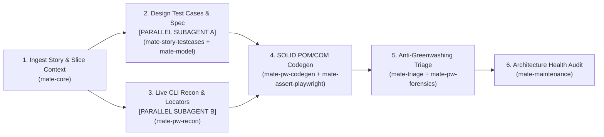

# 📋 Workflow: `/mate-flow-user-story` (User Story to E2E Automation & Triage)

This workflow orchestrates the complete daily engineering loop for a Quality Engineer working with a **User Story, Ticket, or Requirement Document** across 7 synergistic M.A.T.E. skills.

> ⚡ **Parallel Sub-Agent Execution (`[PARALLEL_SUBAGENT_ELIGIBLE]`):**  
> If the host environment supports sub-agents (`invoke_subagent` in Antigravity, `Agent` in Claude Code), **Step 2 (Spec & Test Case Design)** and **Step 3 (Live Playwright Reconnaissance)** can be dispatched concurrently to isolated sub-agents. The primary cockpit thread receives only the synthesized `.page.ts` and `TC-*.md` paths without burning context tokens on raw DOM dumps. See [`docs/SUBAGENTS_AND_PARALLEL_EXECUTION.md`](../docs/SUBAGENTS_AND_PARALLEL_EXECUTION.md).



---

## Step 1: Read Living Map, Slice JIT Context & Ingest User Story (`mate-core` + `mate-story-testcases`)
1. Read `MATE-PROJECT-MAP.md` first and run `npx mate-sdt context <module>` to verify the Tier-1 RAM token budget (`<= 3,000 tokens`) and generate the Just-In-Time Context Pack (`.mate/context-pack-<module>.md`).
2. Ingest the User Story from the source provided by the tester:
   - **Atlassian MCP (Jira / Confluence / Xray):** Fetch the issue summary, description, acceptance criteria, and linked pages via MCP.
   - **Notion / Linear / GitHub Issues MCP:** Fetch the requirement page or ticket via MCP.
   - **Local File (`.xlsx`, `.csv`, `.md`, `.txt`) or Pasted Text:** Read the file or text directly.
3. Apply the **Handling Uncertainty & Epistemic Isolation Protocol**: tag empirical facts as `[OBSERVED]`, deductions as `[INFERRED]`, and ambiguous acceptance criteria as `[TBD]`.

---

## Step 2: Formalize Spec & QA Companion Test Case Matrix (`mate-model` + `mate-story-testcases`)
1. Create or update `specs/[module].mate-spec.md` with `<intent_model>` (including **Explicit Forbidden Transitions**), `<invariants>` (`INV-01..INV-NN`), `<threat_scenarios>`, and `<exploratory_charters>`.
2. Run `npx mate-sdt validate specs/[module].mate-spec.md`.
3. Generate the dual QA Companion Test Case Matrix (`npx mate-sdt cases <module>`):
   - `tests/cases/TC-[module].md` (Rich QA Companion document with traceability, Automated vs. Manual rationale, Manual Test Execution Guide, and tailored Exploratory Testing Recommendations)
   - `tests/cases/TC-[module].csv` (CSV ready for Jira/Xray/Zephyr/Excel/Notion import)
4. Ensure mandatory coverage across all 4 quadrants (`HAPPY_PATH`, `BORDER_CASE`, `NEGATIVE_PATH`, `STATE_TRANSITION`) and classify each scenario using the **Pragmatic Execution Mode Decision Engine**:
   - **`[AUTOMATE_UI]`**: High-ROI end-to-end user flows and DOM state transitions (`tests/e2e/`).
   - **`[AUTOMATE_API]`**: Fast boundary value matrices, field validations, and status codes (`tests/api/`).
   - **`[MANUAL_TEST]`**: Low-ROI automation, visual PDF/print/email rendering, or physical/external flows—with step-by-step instructions for the tester and explicit rationale explaining *why* it should remain manual.
   - **`[EXPLORATORY_CHARTER]`**: Context-aware exploratory missions with border-case heuristics tailored to the User Story.

---

## Step 3: Validate Live Behavior with `@playwright/cli` (`mate-pw-recon`)
1. Open the running application via `playwright-cli open <url>`.
2. Inspect the ARIA tree (`playwright-cli snapshot`) and walk through the designed test cases (`HAPPY_PATH`, `BORDER_CASE`, `NEGATIVE_PATH`) interactively using `fill`, `click`, `select`, `eval`, `console`, and `network`.
3. Extract semantic locators (`getByRole`, `getByLabel`, `getByTestId`) and identify reusable `BaseComponent` vs. `BasePage` boundaries.
4. Record the honest live result (`✅ PASS` vs. `❌ FAIL`) for each `TC-XX` in `tests/cases/TC-[module].md` and `.csv`.
5. Close the CLI browser session (`playwright-cli close`).

---

## Step 4: Automate High-ROI Cases with SOLID Architecture (`mate-pw-codegen` + `mate-assert-playwright` + `mate-assert-api`)
1. Encapsulate discovered locators and actions into:
   - `src/components/<widget>.component.ts` (extending `BaseComponent`)
   - `src/pages/<module>.page.ts` (extending `BasePage`)
   - `src/api/<module>.client.ts` (extending `BaseApiClient`)
   - `src/fixtures/mate.fixtures.ts` (`test.extend<MateFixtures>`)
2. Register new classes and fixtures in `MATE-PROJECT-MAP.md`.
3. Write the automated suites in `tests/e2e/<module>.spec.ts` (for cases marked `AUTOMATE_UI`) and `tests/api/<module>.spec.ts` (for cases marked `AUTOMATE_API`), while leaving `MANUAL_TEST` and `EXPLORATORY_CHARTER` cases clearly documented in `tests/cases/TC-<module>.md` for the human QA engineer.
4. **ENFORCE THE ANTI-GREENWASHING MANDATE:**
   - **Never skip, delete, or weaken a test case just because the application currently fails it!**
   - If `TC-XX` fails against the live application (because of a real product bug violating the User Story / `INV-YY`), **write the test with the true expected assertion** and annotate it with:
     ```typescript
     test.fail(true, 'BUG-YYYYMMDD-MOD-01: App violates AC-02 / INV-02 on TC-XX');
     ```

---

## Step 5: Forensic Evidence & Bug Reporting (`mate-triage` + `mate-pw-forensics`)
1. Execute the automated test suite (`npx playwright test tests/e2e/<module>.spec.ts`).
   > ⚡ **Parallel Sub-Agent Execution:** Delegate test execution to an isolated sub-agent (Template 4 in `docs/SUBAGENTS_AND_PARALLEL_EXECUTION.md`) so verbose terminal output and stack traces do not burn tokens in the primary conversation cockpit.
2. For every test case that exposed a real application bug:
   - Capture screenshot/trace/video evidence via `mate-pw-forensics` if not already captured.
   - Generate a spec-linked Bug Report in `tests/bugs/` via `npx mate-sdt bug <module>`.
   - If an Atlassian/Jira, GitHub Issues, or Notion MCP is connected and the tester requests it, sync or comment the bug report and test cases back to the ticket.

---

## Step 6: 5-Gate Harness Verification Loop & Final Tester Report (`mate-maintenance`)
1. Run `npx mate-sdt gate` (which executes `GATE-01-CONTEXT`, `GATE-02-SPEC-MODEL`, `GATE-03-ANTI-GREENWASHING`, `GATE-04-SOLID-AUDIT`, and persists `.mate/harness-state.json`). If any gate fails, follow the `[SELF-CORRECTION]` prompts until all 5 gates pass.
2. Present a clear **Daily QA Execution Summary** to the tester:
   - **Total Test Cases Designed (`N` across `Happy`, `Border`, `Negative`, `State`):** Breakdown of `[AUTOMATE_UI]`, `[AUTOMATE_API]`, `[MANUAL_TEST]` (with rationale), and `[EXPLORATORY_CHARTER]`.
   - **Passing Automated Tests (`✅ PASS`):** List of verified working scenarios.
   - **Failing Tests Exposing Real Bugs (`⚠️ KNOWN FAIL — test.fail()`):** Explicit callout of which User Story requirements failed, the generated `tests/bugs/BUG-*.md` file paths, and the exact `test.fail()` guards added to the suite.
