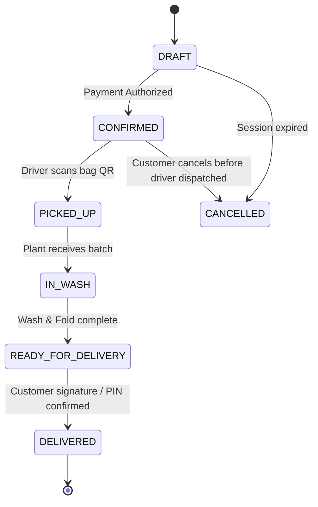

# Specification: Laundry Order Lifecycle & Fulfillment

This document serves as the single source of truth for the laundry order workflow, specifying intent, invariants, adversarial threats, and human exploratory guidelines.

---

<intent_model>
## 1. Domain Intent & Actors
- **Customer:** Places on-demand laundry orders, selects garments, tracks status.
- **Driver:** Picks up laundry bags, updates pickup confirmation.
- **Plant Operator:** Receives bags, marks washing status, completes folding.

## 2. Finite State Machine (FSM)

### Legal State Transitions
| From State | To State | Trigger Event | Authorized Actor |
| :--- | :--- | :--- | :--- |
| `DRAFT` | `CONFIRMED` | Successful payment authorization | System (Stripe Webhook) |
| `CONFIRMED` | `PICKED_UP` | Driver scans physical bag QR | Driver App |
| `PICKED_UP` | `IN_WASH` | Plant intake scan | Plant Operator |
| `IN_WASH` | `READY_FOR_DELIVERY` | Quality inspection completed | Plant Operator |
| `READY_FOR_DELIVERY` | `DELIVERED` | Delivery PIN validated | Driver App |

### Explicitly Forbidden Transitions
- ⛔ `DRAFT` ➔ `PICKED_UP` (Cannot pick up unpaid orders).
- ⛔ `PICKED_UP` ➔ `DELIVERED` (Bypassing washing process is strictly illegal).
- ⛔ `DELIVERED` ➔ `IN_WASH` (Terminal states cannot revert).
- ⛔ `CANCELLED` ➔ `CONFIRMED` (Cancelled orders cannot be resurrected).
</intent_model>

---

<invariants>
## 1. Non-Negotiable System Invariants
- **`INV-01`**: An order must contain at least 1 garment item (`garment_count >= 1`).
- **`INV-02`**: Subtotal cannot be negative under any discount code (`subtotal >= 0.00`).
- **`INV-03`**: Pickup timestamp must be scheduled in the future (`scheduled_at > current_timestamp`).
- **`INV-04`**: Every payment confirmation event must be idempotent across network retries.
</invariants>

---

<threat_scenarios>
## 1. Adversarial & Malicious Edge Cases
- **`THR-01` (Double-Click Checkout Race Condition):** Customer double-clicks the "Pay Now" button within 50ms. Only 1 charge and 1 order id must be created.
- **`THR-02` (Duplicate Webhook Storm):** Stripe sends 5 concurrent webhook deliveries for `payment_intent.succeeded`. System must process transaction exactly once.
- **`THR-03` (Fuzzing Address Fields):** Address lines populated with 4,000 characters, XSS payloads (``), and non-standard UTF-8 emojis. Must sanitize and respond with HTTP 422, never 500.
</threat_scenarios>

---

<exploratory_charters>
## 1. Human Session Charters (Pillar E)
- **Charter E-01 (Mobile Driver UX):**
  - **Mission:** Test driver bag scan workflow in low-connectivity conditions (subway station simulation).
  - **Heuristics:** Ergonomics, clear visual offline feedback, tactile vibration on QR read.
  - **Time-box:** 45 minutes.
- **Charter E-02 (Screen Reader & Accessibility):**
  - **Mission:** Execute full customer order placement using keyboard navigation only and NVDA screen reader.
  - **Compliance Target:** WCAG 2.1 AA.
</exploratory_charters>
