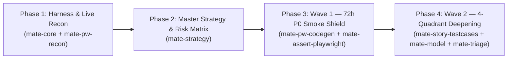

# 🧉 M.A.T.E. SDT Reference Implementation & Live E2E Example
> **Spec-Driven Testing (SDT) Framework** by [Tony Crespo (Un Junior En Apuros)](https://github.com/crespoantonio) & the **M.A.T.E. Method Team**  
> *Target Application:* [Practice Software Testing (Toolshop v5.0)](https://practicesoftwaretesting.com/)  
> *Specifications Source:* [Testsmith Practice Software Testing – Sprint 5 User Stories](https://testsmith-io.github.io/practice-software-testing/#/user-stories/v5)

[-205d96?style=for-the-badge&logo=shield)](./MATE-PROJECT-MAP.md)
[](./tests/e2e/)
[](./src/)
[](https://github.com/mate-sdt/mate-sdt)

---

## 💡 The Origin: What Prompt Started This Entire Repository?

This entire test automation architecture was engineered autonomously from scratch in a single session by an AI agent governed by the **M.A.T.E. Spec-Driven Testing Framework (`mate-sdt`)**.

It all started with this exact initial user request:

> **The Initial Prompt:**  
> ```text
> /mate-core we need to start a new automation framework to test this website: https://practicesoftwaretesting.com/
> The user stories to test are in: https://testsmith-io.github.io/practice-software-testing/#/user-stories/v5
> The goal it's to bring anyone on the team that needs to be part of this so we can cover all the user stories that are mention in here.
> ```

---

## 🚀 How M.A.T.E. Handled It: Zero-to-One in Production

When starting testing on a live web application from a standalone repository, jumping straight into deep edge-case scripts for random screens causes context saturation, locator fragility, and greenwashing.

The master skill **`mate-core`** immediately activated **Workflow `/mate-flow-zero-to-one`**:



### 1. Mobilizing the Specialist Agent Team
To cover all 24 Sprint 5 User Stories comprehensively, `mate-core` summoned the specialist roles:

| Specialist Role | Skill | What They Accomplished |
| :--- | :--- | :--- |
| **Architecture Lead** | **`mate-core`** | Managed [MATE-PROJECT-MAP.md](./MATE-PROJECT-MAP.md) as living Tier-1 RAM context index (`< 3,000` tokens) and enforced SOLID/DIP rules. |
| **QA Strategy Director** | **`mate-strategy`** | Created [docs/TEST-STRATEGY.md](./docs/TEST-STRATEGY.md), cataloging all 24 modules and prioritizing them into P0, P1, and P2 via the M.A.T.E. Risk Formula ($\text{Impact} \times \text{Probability}$). |
| **Live Browser Scout** | **`mate-pw-recon`** | Probed `https://practicesoftwaretesting.com/` using `@playwright/cli` to map semantic locators, ARIA snapshots, and backend API endpoints (`https://api.practicesoftwaretesting.com`). |
| **QA Companion Architect** | **`mate-story-testcases`** | Ingested Sprint 5 User Stories, generating dual QA Companion matrices ([tests/cases/](./tests/cases/)) with 100% Acceptance Criteria traceability and Automated vs. Manual rationale. |
| **Spec Modeler (Pillar M)** | **`mate-model`** | Authored formal specifications ([specs/](./specs/)) with Finite State Machines, mathematical invariants (`INV-01`..`INV-06`), and **Explicit Forbidden Transitions**. |
| **UI Automation Engineers** | **`mate-assert-playwright` & `mate-pw-codegen`** | Created the 4-layer OOP/SOLID architecture (`BaseComponent`, `BasePage`, `MateFixtures`), automated the Wave 1 Smoke Shield, and deepened P0 modules. |
| **API Contract Specialist** | **`mate-assert-api`** | Created typed `AuthApiClient` ([src/api/auth.client.ts](./src/api/auth.client.ts)) testing status matrices (`200`, `401`, `422`, `423`). |
| **Day-2 Quality Guardian** | **`mate-maintenance`** | Audited codebase with `npx mate-sdt audit` ensuring **Grade A (100/100)** with zero arbitrary sleeps and zero anti-patterns. |

---

## 🌊 The 2-Wave Rollout Plan Executed

### 🛡️ Wave 1: The 72-Hour P0 Smoke Survival Shield
Before spending weeks on edge cases, we built an automated horizontal safety net across the **5 Golden Paths** in [tests/e2e/smoke.spec.ts](./tests/e2e/smoke.spec.ts):

1. **`P0-01`**: Product Catalog Browsing & Search Query (`Pliers`)
2. **`P0-02`**: Product Detail Navigation & Real-Time Cart Badge Increment
3. **`P0-03`**: Cart Review & Mathematical Total Calculation Invariant (`INV-01` / `INV-02`)
4. **`P0-04`**: Customer Authentication & Session Establishment (`Jane Doe` session menu)
5. **`P0-05`**: Multi-Step Checkout Navigation to Sign-In Gate

*Result:* **5 / 5 PASSED in 7.5 seconds** across 5 parallel workers.

---

### 🔬 Wave 2: Module-by-Module 4-Quadrant Depth (MOD-01 & MOD-02)
The user instructed the team: *"Let's focus in MOD-01 and MOD-02 please"*.

We deepened **User Registration** and **User Login, Locking & TOTP** through the complete M.A.T.E. loop:

1. **Formal Specifications Validated:**
   - [specs/user-registration.mate-spec.md](./specs/user-registration.mate-spec.md) (AC1–AC6, Invariants `INV-01`–`INV-04`)
   - [specs/user-login.mate-spec.md](./specs/user-login.mate-spec.md) (AC1–AC10, Invariants `INV-01`–`INV-05`, 3-attempt account lockout `INV-03`)
2. **Dual QA Companion Test Case Matrices:**
   - [tests/cases/TC-user-registration.md](./tests/cases/TC-user-registration.md) & [.csv](./tests/cases/TC-user-registration.csv) (8 cases)
   - [tests/cases/TC-user-login.md](./tests/cases/TC-user-login.md) & [.csv](./tests/cases/TC-user-login.csv) (10 cases)
3. **Page Objects & Typed Clients:**
   - [src/pages/register.page.ts](./src/pages/register.page.ts): 12 form inputs, real-time password strength validation (`Weak` ➔ `Moderate` ➔ `Strong` ➔ `Very Strong` ➔ `Excellent`), and duplicate email handling.
   - [src/pages/login.page.ts](./src/pages/login.page.ts): Authentication, account lockout error alerts, and TOTP challenge inputs.
   - [src/api/auth.client.ts](./src/api/auth.client.ts): Typed client testing `POST /users/login`, `POST /users/register`, and `GET /users/me`.
4. **Automated Test Suites:**
   - [tests/e2e/auth-registration.spec.ts](./tests/e2e/auth-registration.spec.ts): Dynamic user registration with unique emails, password strength levels, missing required field blocks, and duplicate email rejection.
   - [tests/e2e/auth-login.spec.ts](./tests/e2e/auth-login.spec.ts): Customer vs Admin dashboard routing, invalid password messages, and session persistence.
   - [tests/api/auth.spec.ts](./tests/api/auth.spec.ts): REST contract checks verifying `200 OK` bearer tokens, `401 Unauthorized`, `422 Unprocessable` duplicate email errors, and protected profile access.

---

## 🏛️ 4-Layer OOP / SOLID Architecture

M.A.T.E. strictly enforces Object-Oriented Design and Dependency Inversion:

```
src/
├── components/          <-- BaseComponent & Reusable UI Widgets
│   ├── base.component.ts
│   ├── navbar.component.ts
│   └── notification-toast.component.ts
├── pages/               <-- Page Objects extending BasePage (SRP / OCP)
│   ├── base.page.ts
│   ├── catalog.page.ts
│   ├── product-detail.page.ts
│   ├── cart.page.ts
│   ├── login.page.ts
│   └── register.page.ts
├── api/                 <-- Typed API Clients extending BaseApiClient
│   ├── base-api.client.ts
│   └── auth.client.ts
└── fixtures/            <-- Dependency Inversion (DIP) Playwright Fixtures
    └── mate.fixtures.ts
```

> **Strict Rule:** Test files never call `new SomePage(page)`. Page Objects and API clients are injected via `test.extend<MateFixtures>()` in [src/fixtures/mate.fixtures.ts](./src/fixtures/mate.fixtures.ts).

---

## 📊 Current Framework Health & Execution Metrics

```
══════════════════════════════════════════════════════════════════════════════════
 🧉 M.A.T.E. GOVERNANCE STATUS: ALL PASSING
══════════════════════════════════════════════════════════════════════════════════
  ✔ API Contract Suite (npm run test:api):       4 / 4 PASSED (2.5s)
  ✔ Full E2E UI Suite (npm run test:e2e):       12 / 12 PASSED (10.5s)
  ✔ Wave 1 Smoke Shield (npm run test:smoke):   11 / 11 PASSED (12.5s)
  ✔ Test Suite Health Score (npx mate-sdt audit): Grade A (100/100 across 17 files)
  ✔ Anti-Patterns Detected:                     0 (Zero arbitrary sleeps, full DIP)
  ✔ Specifications Validated:                   3 / 3 APPROVED
══════════════════════════════════════════════════════════════════════════════════
```

---

## ⚡ Quick Start: Running the Suite Locally

### 1. Prerequisites
- **Node.js** `>= 20.0.0`
- **npm** `>= 10.0.0`

### 2. Installation
```bash
git clone https://github.com/mate-sdt/mate-sdt-example.git
cd mate-sdt-example
npm install
npx playwright install chromium
```

### 3. Environment Setup
The repository comes pre-configured with [.env.example](./.env.example):
```bash
cp .env.example .env
```

### 4. Running the Tests
```bash
# Run the Wave 1 P0 Smoke Survival Shield (< 15 seconds)
npm run test:smoke

# Run all E2E UI Workflows
npm run test:e2e

# Run API Contract Suites
npm run test:api

# Run M.A.T.E. Quality Audit (Health Score A-F)
npx mate-sdt audit

# Validate Specifications against SDT Standard
npx mate-sdt validate

# Inspect M.A.T.E. Governance Status
npx mate-sdt status
```

---

## 📜 Key Architectural Concepts Demonstrated

1. **Context Engineering:**  
   [MATE-PROJECT-MAP.md](./MATE-PROJECT-MAP.md) acts as the living Tier-1 RAM index (`< 3,000` tokens). Coding agents read this map first, preventing full-repository context saturation.
2. **The Anti-Greenwashing Mandate:**  
   The User Story and formal specification are the single source of truth—never the live application when it misbehaves. Real application defects are preserved with true assertions and annotated with `test.fail(true, 'BUG-XXX')`.
3. **Zero Arbitrary Sleeps:**  
   `page.waitForTimeout()` and arbitrary delays are strictly forbidden (`MATE-ANTI-01`). All waits rely on locator auto-retries and web assertions.
4. **Dual QA Companion Documents:**  
   Every module receives both a rich Markdown companion ([tests/cases/*.md](./tests/cases/)) and a Jira/Xray/Zephyr-ready CSV export ([tests/cases/*.csv](./tests/cases/)).

---

## 🤝 About M.A.T.E. (Spec-Driven Testing)

**M.A.T.E.** is a modern QA engineering method and framework created by **Antonio "Tony" Crespo** (*Un Junior En Apuros*). It unites human QA strategy with AI agent orchestration across four core pillars:
- **M**odel: Formal specifications, FSMs, and explicit Forbidden Transitions.
- **A**ssert: SOLID Page Objects, DIP fixtures, and contract matrices.
- **T**hreat & Trash: Concurrency, fuzzing, and Stryker mutation testing.
- **E**xplore: Human Session-Based Test Management (SBTM) charters and release governance.

*Core CLI Framework:* [`mate-sdt`](https://github.com/mate-sdt/mate-sdt)  
*License:* MIT
