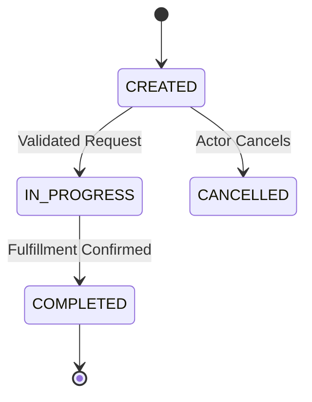

# 🧉 MATE-SPEC: [Feature or Module Name]
<!--
  M.A.T.E. METHOD — Spec-Driven Testing (SDT) Framework
  Created by Antonio "Tony" Crespo (@crespoantonio / Un Junior En Apuros)
  Validate this specification anytime with: npx mate-sdt validate specs/<file>.mate-spec.md
-->

This document serves as the single source of truth for this module, governing business intent, deterministic invariants, adversarial threat scenarios, and human exploratory charters.

---

<intent_model>
## 1. 🗺️ M — Model (Intent, State Machines & Contracts)

### Business Context & Domain Actors
- **Primary Actor:** [Describe who initiates the workflow and what business value they achieve]
- **System / Secondary Actors:** [Describe background services, webhooks, or external actors]

### Finite State Machine (FSM)



### Legal State Transitions
| From State | To State | Trigger Event | Authorized Actor |
| :--- | :--- | :--- | :--- |
| `CREATED` | `IN_PROGRESS` | Validation & authorization succeeded | System / API |
| `IN_PROGRESS` | `COMPLETED` | Processing confirmed | Domain Worker |
| `CREATED` | `CANCELLED` | Cancellation requested before processing | Primary Actor |

### Explicitly Forbidden Transitions
- ⛔ `CREATED` ➔ `COMPLETED` (Forbidden bypass of `IN_PROGRESS` validation and processing).
- ⛔ `COMPLETED` ➔ `IN_PROGRESS` (Forbidden reversal from immutable terminal state).
- ⛔ `CANCELLED` ➔ `COMPLETED` (Forbidden resurrection of cancelled entity).

### Technical Contracts & Interfaces
- **Endpoint:** `POST /api/v1/[resource]`
- **Request Schema (Strict Types — Zero `any`):**
  ```json
  {
    "idempotency_key": "uuid-v4",
    "amount": "number (> 0)",
    "currency": "USD | EUR | ARS"
  }
  ```
- **Response Schema (`201 Created`):**
  ```json
  {
    "id": "uuid-v4",
    "status": "CREATED",
    "created_at": "ISO-8601"
  }
  ```
</intent_model>

---

<invariants>
## 2. 🎯 A — Assert (Deterministic Oracles & Sacred Invariants)

### Business & Mathematical Invariants
- **`INV-01`**: [Sacred Rule 1 — e.g., Item quantity must be strictly greater than zero (`quantity > 0`).]
- **`INV-02`**: [Sacred Rule 2 — e.g., Total charged must equal `subtotal + taxes - discount` to the exact cent.]
- **`INV-03`**: [Sacred Rule 3 — e.g., Every state mutation must emit an immutable audit log entry.]

### Performance & Architectural Oracles (NFRs)
- **`ORA-LATENCY`**: P95 response time <= `400ms` under sustained load of `200 RPS`.
- **`ORA-SYNC`**: Zero arbitrary sleeps (`waitForTimeout` / `sleep` strictly prohibited in all test suites).
- **`ORA-SOLID`**: All UI assertions must use Dependency Inversion (Playwright fixtures) and Page/Component Object Models.
</invariants>

---

<threat_scenarios>
## 3. 💣 T — Threat & Trash (Adversarial Engineering & Mutation Governance)

### Adversarial & Edge-Case Scenarios
- **`THR-01` (Concurrency / Double-Click Race Condition):** Two identical requests dispatched within `50ms` with the same `idempotency_key` must resolve idempotently, creating a single record and returning the same status without duplicate side effects.
- **`THR-02` (Data Trash & Payload Fuzzing):** Injecting 10,000-character strings, XSS/SQLi payloads, negative numbers, and non-UTF8 sequences must be rejected cleanly with `HTTP 422 Unprocessable Entity` and zero stack-trace leakage.
- **`THR-03` (Downstream Dependency Failure):** If an external gateway times out (`> 5000ms`) or returns `HTTP 503`, the system must trip its circuit breaker and preserve database consistency.

### Mutation Testing Governance
- **Engine:** Stryker Mutator executed inside an isolated rootless **Podman** container (`npx mate-sdt mutate`).
- **Threshold:** **Mutation Score >= 85%** (Break threshold: `85%`). Surviving mutants in core business logic block release.
</threat_scenarios>

---

<exploratory_charters>
## 4. 🧭 E — Explore (Human Exploratory Testing Charters)

### Session-Based Test Management (SBTM) Missions
- **Charter `CHR-01` (Duration: 45 minutes):**
  - **Target:** End-to-end user workflow on mobile viewport under throttled network conditions.
  - **Heuristics:** Ergonomics, visual feedback clarity, emotional trust during async transitions, graceful back-button recovery.
- **Charter `CHR-02` (Duration: 30 minutes):**
  - **Target:** Web Accessibility (a11y) & Screen Reader Audit.
  - **Heuristics:** WCAG 2.1 AA compliance, 100% keyboard-only navigation (`Tab`, `Shift+Tab`, `Enter`, `Escape`), `aria-live` error announcements.
</exploratory_charters>

---

## 🚦 Official M.A.T.E. Release Verdict

<release_decision>
- [ ] **`[PASS]`**: 100% of invariants green, Mutation Score >= 85%, and Exploratory Charters completed with zero blockers.
- [ ] **`[CONCERNS]`**: Non-critical deviation identified. Requires a formal signed Release Waiver (`npx mate-sdt waiver <module>`).
  - *Waiver File / Issue ID:* `[specs/waivers/WVR-YYYY-module.md / ISSUE-123]`
  - *Quality Lead Signature:* `[@handle]` | *Tech Lead Signature:* `[@handle]`
- [ ] **`[FAIL]`**: Broken invariant, security vulnerability, or severe UX defect. Deployment pipeline blocked.
</release_decision>
