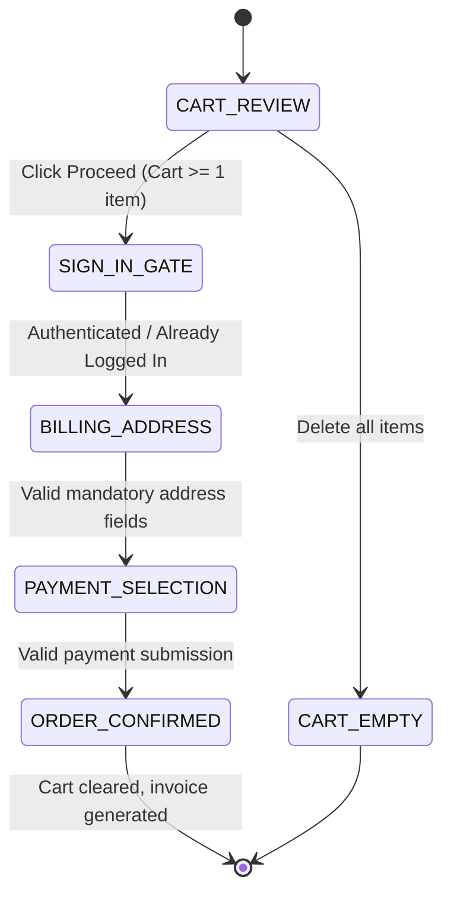

# Specification: Checkout, Cart & Payment Lifecycle (MOD-05 to MOD-08)

This specification governs the complete e-commerce purchase workflow, cart recalculations, multi-step customer gating, address validation, and payment processing for Practice Software Testing (Toolshop v5.0).

---

<intent_model>
## 1. Domain Intent & Actors
- **Customer / Guest:** Adds products to cart, reviews totals, submits billing address, and provides payment.
- **Checkout Wizard Engine:** Manages linear 4-step wizard progression (`Cart -> Sign In -> Address -> Payment -> Confirmation`).
- **Payment Gateway Service:** Authorizes transaction and persists invoice record.

## 2. Finite State Machine (FSM)

### Legal State Transitions
| From State | To State | Trigger Event | Authorized Actor |
| :--- | :--- | :--- | :--- |
| `CART_REVIEW` | `SIGN_IN_GATE` | Click Proceed with cart quantity >= 1 | Customer / Guest |
| `SIGN_IN_GATE` | `BILLING_ADDRESS` | Customer authenticated or session detected | Customer |
| `BILLING_ADDRESS` | `PAYMENT_SELECTION` | All required address fields filled & valid | Customer |
| `PAYMENT_SELECTION` | `ORDER_CONFIRMED` | Select method & submit order | Payment Gateway |

### Explicitly Forbidden Transitions
- ⛔ `CART_REVIEW` ➔ `PAYMENT_SELECTION` directly (Bypassing authentication and billing address is strictly illegal).
- ⛔ `CART_EMPTY` ➔ `SIGN_IN_GATE` (Cannot checkout with empty cart).
- ⛔ `BILLING_ADDRESS` ➔ `PAYMENT_SELECTION` with empty required address fields (`proceed` button must remain disabled).
- ⛔ `ORDER_CONFIRMED` ➔ `PAYMENT_SELECTION` (Completed orders cannot re-submit payment).
</intent_model>

---

<invariants>
## 1. Non-Negotiable System Invariants
- **`INV-01`**: Cart item quantities must be integers `>= 1`; item total must strictly equal `quantity * unit_price`.
- **`INV-02`**: Cart calculation invariant: `Cart Total = Sum(Line Prices) - Discount + Shipping + Tax`.
- **`INV-03`**: Billing address validation invariant: `Proceed` button to payment step is strictly disabled when any required field (`street`, `city`, `state`, `country`, `postal_code`) is empty.
- **`INV-04`**: Order confirmation invariant: Successful payment placement clears the active cart session, displays order confirmation, and assigns an invoice number.
</invariants>

---

<threat_scenarios>
## 1. Adversarial & Chaos Scenarios (Pillar T)
- **`THREAT-CHK-01` (Negative Quantity & Price Tampering):** Modifying DOM quantity inputs or API payload to `0`, negative numbers, or decimal fractions must be rejected with HTTP 422.
- **`THREAT-CHK-02` (Rapid Double-Submit on Payment):** Rapidly double-clicking the `Confirm` button on Step 4 must only create exactly 1 invoice and charge the payment gateway once.
- **`THREAT-CHK-03` (Expired Credit Card Validation):** Submitting a card with an expired MM/YYYY date must be rejected before gateway submission with "Expiration date must be in the future.".
</threat_scenarios>

---

<exploratory_charters>
## 1. Human Session-Based Charters (Pillar E)
- **`CHR-CHK-01` (Multi-Step Back/Forward Button Navigation):** Navigate through Step 1 to Step 3, click browser Back button to Step 1, modify quantity, and resume forward. Ensure state consistency.
- **`CHR-CHK-02` (Payment Method Switching Ergonomics):** Switch between Credit Card, Bank Transfer, Buy Now Pay Later, and Cash on Delivery. Verify field reset and validation trigger timing.
</exploratory_charters>
