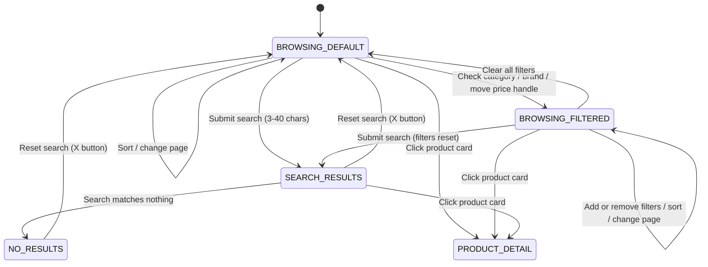

# Specification: Product Overview, Search, Filters, Sort & Price Range (MOD-03)

This specification governs the paginated product catalog (home page) of Practice Software Testing (Toolshop v5.0): grid rendering, search, category/brand filters, sorting and the price range slider.

**Source User Story:** [Sprint 5 - Product Overview + Price Range](https://testsmith-io.github.io/practice-software-testing/#/user-stories/v5) (AC1-AC13).

---

<intent_model>
## 1. Domain Intent & Actors
- **Visitor (anonymous or authenticated):** Browses, searches, filters and sorts the catalog to find products within preference and budget.
- **Catalog API (Backend):** `QUERY /products` (HTTP QUERY, filters sent in the request body) and `GET /products/search` return the paginated product set; `GET /brands`, `GET /categories/tree` feed the filter sidebar. `[OBSERVED]`

## 2. Finite State Machine (FSM)

### Legal State Transitions
| From State | To State | Trigger Event | Authorized Actor |
| :--- | :--- | :--- | :--- |
| `BROWSING_DEFAULT` | `BROWSING_FILTERED` | Category/brand checkbox checked or price handle moved | Visitor |
| `BROWSING_DEFAULT` / `BROWSING_FILTERED` | `SEARCH_RESULTS` | Search submitted with 3-40 characters (all filters reset) | Visitor |
| `SEARCH_RESULTS` | `NO_RESULTS` | Query matches no product | Catalog API |
| `SEARCH_RESULTS` / `NO_RESULTS` | `BROWSING_DEFAULT` | Search reset button | Visitor |
| Any browsing state | `PRODUCT_DETAIL` | Product card clicked | Visitor |

### Explicitly Forbidden Transitions
- ⛔ `SEARCH_RESULTS` ➔ `SEARCH_RESULTS` **with previous filters still active** (a new search must reset every filter - AC4).
- ⛔ `BROWSING_*` ➔ backend search request for a query **shorter than 3 characters** `[OBSERVED]` (UI must not issue the request).
- ⛔ `NO_RESULTS` ➔ rendering of unescaped query text as HTML/script (query must be displayed as plain text).
- ⛔ Any browsing state ➔ `HTTP 5xx` surfaced to the visitor for arbitrary search text (XSS/SQLi payloads must resolve to empty state).

### Technical Contracts & Interfaces `[OBSERVED]`
- **Catalog:** `QUERY https://api.practicesoftwaretesting.com/products` (HTTP QUERY method, no query string).
- **Search:** `GET https://api.practicesoftwaretesting.com/products/search?q=<query>`.
- **Sort option values:** `name,asc` | `name,desc` | `price,asc` | `price,desc` | `co2_rating,asc` | `co2_rating,desc`.
- **Page size:** 9 products per page.
- **Whitespace-only query (`DEC-OVR-01`, provisional):** a query made only of whitespace that reaches 3 characters (e.g. `"   "`) is **accepted as a valid search**: `GET /products/search` is issued, the caption echoes the raw text and the empty state `There are no products found.` is shown. No trimming is applied. `[OBSERVED]` + engineer decision 2026-11-12.
- **Locale:** copy is localized from the browser locale; the test harness pins `locale: 'en-US'` (environment-noise control, decision 2026-11-12).
</intent_model>

---

<invariants>
## 1. Non-Negotiable System Invariants
- **`INV-01`**: Every product card shows an image, a name and a price (AC1).
- **`INV-02`**: A search is only executed for queries of **3-40 characters**; shorter queries issue no backend request (AC4, border). Length is measured on the raw input (no trimming), so a 3-space query is executed (`DEC-OVR-01`, provisional).
- **`INV-03`**: Submitting a search resets all active category/brand filters (AC4).
- **`INV-04`**: Category hierarchy consistency - checking a parent checks all children; unchecking every child unchecks the parent (AC6).
- **`INV-05`**: Combined filters return the **intersection** of the individual filter results (AC8).
- **`INV-06`**: With a price range applied, every displayed product price lies within `[min, max]` (AC11).
- **`INV-07`**: Sorting is total and monotonic over the displayed set: names alphabetical (A-Z / Z-A), prices ascending/descending (AC9).

## 2. Performance & Architectural Oracles (NFRs)
- **`ORA-PERF-01`**: Product catalog search and filter responses must render within `p95 <= 800ms`.
- **`ORA-SYNC`**: Zero arbitrary sleeps; catalog reloads are synchronized on network responses and web-first assertions.
- **`ORA-SOLID`**: UI assertions go through `CatalogPage` and injected fixtures only.
</invariants>

---

<threat_scenarios>
## 1. Adversarial & Chaos Scenarios (Pillar T)
- **`THREAT-OVR-01` (Search Injection):** `` and `' OR 1=1 --` must render as plain text with the empty state and no server error (covered by `TC-OVR-08`).
- **`THREAT-OVR-02` (Oversize Query):** 41+ character and very large (10k) queries must not crash the page or return `5xx` `[TBD: API-level fuzz in tests/threats]`.
- **`THREAT-OVR-03` (Filter Tampering):** Manipulating the `QUERY /products` body (negative prices, `min > max`, non-existent category IDs) must return `4xx`/empty set, never `5xx` `[TBD]`.
</threat_scenarios>

---

<exploratory_charters>
## 1. Human Session-Based Charters (Pillar E)
- **`CHR-OVR-01` (Filter Combinatorics, 45 min):** Mix category + brand + eco-friendly + price range + sort + pagination; verify page number resets on filter change and no stale results after rapid toggling.
- **`CHR-OVR-02` (Price Slider Ergonomics, 30 min):** Drag, keyboard, touch and min>max crossing of the slider handles; verify announced values for screen readers.
- **`CHR-OVR-03` (Discount & Stock Presentation, 30 min):** Locate discounted products (strikethrough original price, AC12) and out-of-stock products (AC13) across all pages; these are data-dependent and not stably automatable.
</exploratory_charters>

---

## Open Items `[TBD]`
- **AC12 (discount strikethrough)** and **AC13 (out of stock label):** no discounted product was observed on page 1 and stock state is volatile test data - tracked as `MANUAL_TEST` / `EXPLORATORY_CHARTER` until a deterministic data fixture or API mock exists.
- ~~**Whitespace-only search** (`"   "`)~~ **RESOLVED 2026-11-12 (engineer decision, provisional):** the UI sends the request and shows the empty state `[OBSERVED]`; AC4 does not define trimming. Classified as **acceptable behavior for now** (not a defect, no `test.fail()`). Recorded as `DEC-OVR-01` and pinned by `TC-OVR-20`. Revisit if Product later defines input trimming; a change here is a **Spec Update**, not a bug fix.
- **Eco-friendly filter** ("Show only eco-friendly products") and **CO₂ sort** are present in the UI but not covered by Sprint 5 AC1-AC13.
