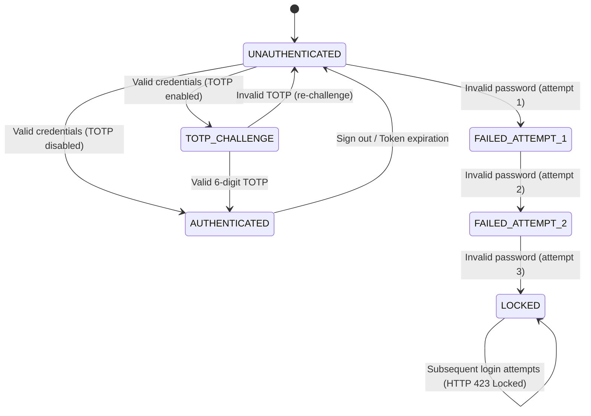

# Specification: User Login, Locking & TOTP (MOD-02)

This specification governs user authentication, multi-role redirection, consecutive failed attempt account locking (`INV-03`), and Two-Factor Authentication (TOTP) for Practice Software Testing (Toolshop v5.0).

---

<intent_model>
## 1. Domain Intent & Actors
- **Customer / Admin:** Enters credentials or TOTP challenge to access privileged areas.
- **Security Guardian (Backend API):** Authenticates hashes, manages failure attempt counters, enforces account lockout at 3 failed attempts, and signs JWT/Bearer tokens.

## 2. Finite State Machine (FSM)

### Legal State Transitions
| From State | To State | Trigger Event | Authorized Actor |
| :--- | :--- | :--- | :--- |
| `UNAUTHENTICATED` | `AUTHENTICATED` | Valid email & password submitted (no 2FA) | Customer or Admin |
| `UNAUTHENTICATED` | `TOTP_CHALLENGE` | Valid credentials submitted for 2FA user | Security Service |
| `TOTP_CHALLENGE` | `AUTHENTICATED` | Valid 6-digit TOTP code submitted | 2FA User |
| `UNAUTHENTICATED` | `FAILED_ATTEMPT_1` | First invalid credential submission | Any Actor |
| `FAILED_ATTEMPT_1` | `FAILED_ATTEMPT_2` | Second consecutive failed submission | Any Actor |
| `FAILED_ATTEMPT_2` | `LOCKED` | Third consecutive failed submission | Security Service |
| `AUTHENTICATED` | `UNAUTHENTICATED` | User clicks sign out | Authenticated User |

### Explicitly Forbidden Transitions
- ⛔ `UNAUTHENTICATED` ➔ `AUTHENTICATED` with invalid password under any condition.
- ⛔ `LOCKED` ➔ `AUTHENTICATED` via standard password login without admin unlocking (must return HTTP 423 Locked).
- ⛔ `ADMIN` account ➔ `LOCKED` (Admin role is strictly exempt from account lockout).
- ⛔ `DISABLED` account ➔ `AUTHENTICATED` (Must reject with "Account disabled.").
</intent_model>

---

<invariants>
## 1. Non-Negotiable System Invariants
- **`INV-01`**: Role-based destination invariant: Successful Customer login routes to `/account`; successful Admin login routes to `/admin/dashboard`.
- **`INV-02`**: Single failed credential submission must display generic error `Invalid email or password` with HTTP 401.
- **`INV-03`**: Account Locking Invariant: After exactly 3 consecutive failed login attempts on a customer account, subsequent login attempts must return `HTTP 423 Locked` and display `Account locked, too many failed attempts. Please contact the administrator.`.
- **`INV-04`**: Admin accounts (`admin@practicesoftwaretesting.com`) must NEVER lock, regardless of the number of consecutive failed attempts.
- **`INV-05`**: TOTP validation requires exactly a 6-digit numeric token; invalid tokens return `Invalid TOTP`.
</invariants>

---

<threat_scenarios>
## 1. Adversarial & Chaos Scenarios (Pillar T)
- **`THREAT-AUTH-01` (Brute-Force Attack Resistance):** Rapid firing of 20 dictionary attack password payloads must be completely halted after attempt #3 by the HTTP 423 Locked barrier.
- **`THREAT-AUTH-02` (TOTP Replay & Expiration):** A previously used 6-digit TOTP code must not be reusable within the same or subsequent time window.
- **`THREAT-AUTH-03` (BOLA / Vertical Privilege Escalation):** Standard customer tokens must be rejected with HTTP 403 when requesting admin endpoints (`/admin/dashboard`, `/users`).
</threat_scenarios>

---

<exploratory_charters>
## 1. Human Session-Based Charters (Pillar E)
- **`CHR-AUTH-01` (Social Login Popup & Cancellation):** Open Google Social Login popup, close popup window before authorization, and verify parent window recovers gracefully without UI freezing.
- **`CHR-AUTH-02` (Session Expiry & Back-Button Tampering):** Log in, invalidate session via cookie deletion, press browser Back button, and ensure sensitive account data is not served from cache.
</exploratory_charters>
