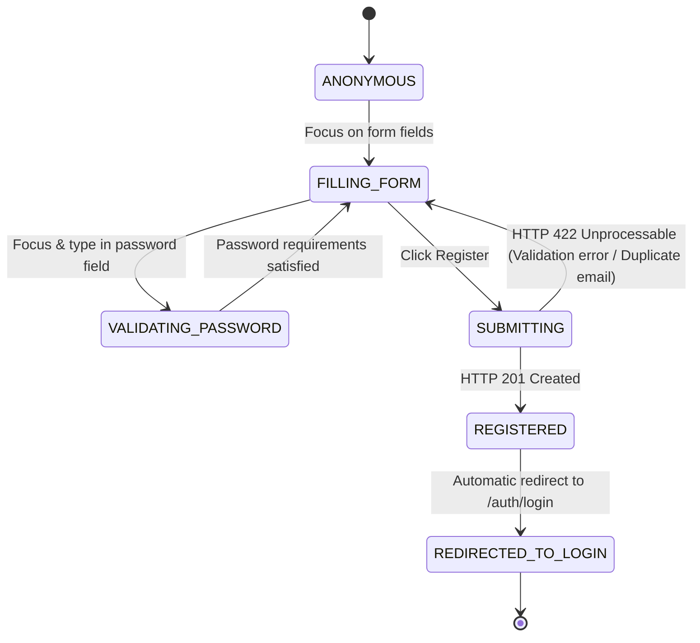

# Specification: User Registration & Password Strength (MOD-01)

This specification governs the new customer registration lifecycle, input validation, real-time password criteria, and password strength evaluation for Practice Software Testing (Toolshop v5.0).

---

<intent_model>
## 1. Domain Intent & Actors
- **Visitor (Anonymous):** Submits personal and address details to create an authenticated customer account.
- **Identity Provider (Backend API):** Validates RFC compliance, checks email uniqueness, hashes password, and persists user record.

## 2. Finite State Machine (FSM)

### Legal State Transitions
| From State | To State | Trigger Event | Authorized Actor |
| :--- | :--- | :--- | :--- |
| `ANONYMOUS` | `FILLING_FORM` | Visitor navigates to `/auth/register` | Anonymous Visitor |
| `FILLING_FORM` | `VALIDATING_PASSWORD` | User focuses password input | Anonymous Visitor |
| `VALIDATING_PASSWORD` | `FILLING_FORM` | User completes password criteria | Anonymous Visitor |
| `FILLING_FORM` | `SUBMITTING` | Form submitted with required fields | Anonymous Visitor |
| `SUBMITTING` | `REGISTERED` | Backend creates customer record | Identity Service |
| `REGISTERED` | `REDIRECTED_TO_LOGIN` | UI navigates to `/auth/login` | Frontend Router |

### Explicitly Forbidden Transitions
- ⛔ `ANONYMOUS` ➔ `REGISTERED` without submitting valid required fields and password meeting all 4 criteria.
- ⛔ `SUBMITTING` ➔ `REGISTERED` when email already exists in identity database (must reject with "Email is already in use.").
- ⛔ `REGISTERED` ➔ `AUTHENTICATED` directly without explicit login authentication step.
</intent_model>

---

<invariants>
## 1. Non-Negotiable System Invariants
- **`INV-01`**: All mandatory fields (`first_name`, `last_name`, `dob`, `country`, `postal_code`, `street`, `city`, `state`, `phone`, `email`, `password`) must be validated; missing any required field blocks form submission.
- **`INV-02`**: Password must satisfy all 4 criteria: at least 8 characters, both uppercase and lowercase letters, at least one digit, and at least one special character.
- **`INV-03`**: Password strength indicator must accurately reflect fulfilled criteria:
  - 1 criterion: `Weak` (20%)
  - 2 criteria: `Moderate` (40%)
  - 3 criteria: `Strong` (60%)
  - 4 criteria: `Very Strong` (80%)
  - 5 criteria (all + length >= 12): `Excellent` (100%)
- **`INV-04`**: Duplicate email registration attempts must return `HTTP 422` with message `Email is already in use.`.
</invariants>

---

<threat_scenarios>
## 1. Adversarial & Chaos Scenarios (Pillar T)
- **`THREAT-REG-01` (SQLi & XSS in Registration Inputs):** Injected scripts (``) or SQL payloads in Name/Street fields must be properly sanitized and rendered as text.
- **`THREAT-REG-02` (Concurrent Duplicate Registration):** Two simultaneous `POST /users/register` requests with the exact same email must never create duplicate records; the second request must return `422`.
- **`THREAT-REG-03` (Password Length Fuzzing):** Passwords exceeding 256 characters or containing Unicode surrogate pairs must not crash the bcrypt hashing service.
</threat_scenarios>

---

<exploratory_charters>
## 1. Human Session-Based Charters (Pillar E)
- **`CHR-REG-01` (Password Strength Ergonomics):** Explore typing speed variations and clipboard paste actions into the password field to verify real-time indicator updates.
- **`CHR-REG-02` (Internationalization & Postcode Formats):** Test various country postcodes (alphanumeric vs purely numeric) and phone number formatting variations across locales.
</exploratory_charters>
